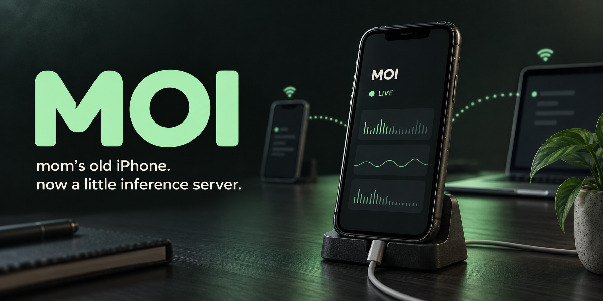

# MOI

**mom’s old iPhone. now a little inference server.**

MOI is a native iPhone app that runs a small language model on the phone and serves a local HTTP API. Give a spare phone power and Wi-Fi, open MOI, and let your other projects call it.

The dashboard shows app memory, available memory, battery, thermal pressure, connected clients, completed requests, and measured generation speed. Prompts and responses are not saved by MOI. No cloud inference service is used.

This is an early prototype. Qwen 3 0.6B and Gemma 3 270M run on a physical iPhone 11 and pass real Wi-Fi chat and streaming API checks. See [validation](docs/VALIDATION.md) for measurements and remaining limits.

## One-command setup from a Mac

Connect the iPhone by USB, unlock it, then clone the repository and start setup:

```sh
git clone https://github.com/lalomorales22/moi.git
cd moi
./start.sh
```

If you already have the repository, run `./start.sh` from its folder.

This is the complete setup, including the model. `./start.sh install` does the same thing. It:

1. Checks full Xcode, the iOS SDK, connected iPhone, iOS version, Developer Mode, and signing identity. If multiple phones or signing teams are available, it asks which one to use.
2. Uses XcodeGen if installed, or downloads the pinned, SHA-256-verified XcodeGen 2.46.0 into `.cache/tools`. Homebrew is not required, and it does not change global Xcode settings.
3. Downloads Qwen 3 0.6B on the Mac and verifies its exact size and SHA-256. A valid cached download is reused. No Hugging Face account or token is needed.
4. Builds a signed Release app using your Apple account and installs it on the selected iPhone.
5. Copies the model into the app over USB and writes a one-time setup request. Other downloaded models and the phone's API key are preserved.
6. Launches MOI. The phone verifies and loads the model, generates a short test reply, and starts serving automatically.
7. Waits for a receipt matching this installation and checks that this Mac can reach the phone's chat page over Wi-Fi. Only then does it print **MOI is ready** and the website/API URLs.

Open **Connect** on the iPhone and scan the QR from your other phone to chat. You can disconnect USB once setup succeeds; inference runs entirely on the iPhone. Keep MOI open, powered, and connected to Wi-Fi.

### What you need first

- A Mac with **full Xcode**, its iOS platform installed, and Python 3.9 or newer. Xcode 26.6 is the tested version. Command Line Tools alone cannot build/install this app; older Xcode versions may not support your phone or the pinned runtime. Open Xcode once to complete its first-launch setup and accept Apple's license. Download it from the [Mac App Store](https://apps.apple.com/app/xcode/id497799835) or [Apple Developer](https://developer.apple.com/xcode/).
- Your Apple account added in **Xcode → Settings → Accounts**. A paid developer membership is not required for personal testing. If no signing identity exists, select your team → **Manage Certificates → + → Apple Development**, or supply `MOI_TEAM_ID` and let Xcode manage signing.
- A physical iPhone on **iOS 17 or newer** with room for the app and model. The verified device is an iPhone 11 with 4 GB RAM; meeting the iOS requirement does not prove every older phone will run a model reliably.
- Internet on the Mac for dependencies, model downloads, and Apple provisioning. The Mac and iPhone must be on the same trusted Wi-Fi for the final connection check. Allow several GB of free Mac storage for dependencies/builds, beyond the 345 MB Qwen model.

### The few things Apple requires you to tap

The script gives instructions and lets you retry in an interactive terminal. These steps cannot be silently completed by an installer:

1. Unlock the iPhone and tap **Trust** when it asks to trust this computer.
2. Enable **Settings → Privacy & Security → Developer Mode**, restart, then confirm **Turn On**. If the setting is missing, open **Xcode → Window → Devices and Simulators** with the unlocked phone connected. See [Apple's Developer Mode guide](https://developer.apple.com/documentation/xcode/enabling-developer-mode-on-a-device).
3. If opening MOI says **Untrusted Developer**, go to **Settings → General → VPN & Device Management → Developer App**, select your own developer profile, and trust it. Return to the terminal and continue, or rerun `./start.sh`.
4. Allow **Local Network** access when MOI asks, and keep the app open during setup.

MOI never asks for your Apple password. Signing is handled by Xcode. With a free Personal Team, Apple's provisioning profiles expire after seven days; rerun `./start.sh` to rebuild/reinstall. See [Apple's Personal Team limits](https://developer.apple.com/help/account/basics/about-your-developer-account).

### Options and rerunning setup

```sh
./start.sh --model gemma-3-270m       # Full setup with the smaller CPU model
./start.sh doctor                    # Xcode/signing/connected-device diagnostics
./start.sh install --app-only        # Developer option: update only the app
./start.sh build                     # Unsigned compile check; no phone needed
./start.sh push-model gemma-3-270m    # Add a model to an already installed app
./start.sh --help
```

`MOI_DEVICE_ID`, `MOI_TEAM_ID`, `MOI_BUNDLE_ID`, and `MOI_MODEL` can select the phone, signing team, app identifier, and default setup model. For example:

```sh
MOI_TEAM_ID=YOUR_TEAM_ID ./start.sh
```

New installs use a team-specific bundle identifier to avoid everyone registering the same app ID. Existing `com.moi.phone` installations are detected and updated in place. The installer remembers the successful device/team/bundle mapping in ignored `.cache/install-settings.json`. A custom `MOI_BUNDLE_ID` is remembered for later setup and model transfers; changing it creates a separate app with separate data.

Setup is safe to rerun: verified Mac model downloads are reused, other phone models are retained, and the API key stays in the phone's Keychain. Installing/launching a new build interrupts active chats and invalidates old QR browser sessions; scan the fresh QR afterward. Gemma 4 is deliberately excluded from automatic setup because it failed on the iPhone 11. It remains a separate experimental model on suitable hardware.

Build logs and non-secret setup receipts are stored in ignored `.cache/setup-*` directories. Setup waits up to 180 seconds after launch; use `--wait-seconds 300` if more time is needed for on-phone steps. A failed build, phone error, timeout, or unreachable LAN page exits with a nonzero status and instructions. In a noninteractive terminal, owner-action steps also exit instead of hanging for input. The script never reports a timed-out installation as ready. Fix the reported issue and rerun the same command.

### After setup

The automatic setup request is consumed once. After a later app restart, open **Model → Load model → Station → Start serving**. Locking the iPhone or leaving the app stops serving; return to MOI and tap **Start serving** again if the model is still loaded. Serving keeps the screen awake.

If you used `--app-only`, select/download a model in **Model**, tap **Load model**, then **Start serving** in Station. You can also run the full `./start.sh` to prepare it automatically.

Open **Connect** and scan the QR from another device on the same Wi-Fi. Pairing happens automatically; there is no API key to type. Chat back and forth: your message moves into the conversation, the typing box clears, and MOI streams its reply. Type your next message while it answers, tap Stop to interrupt, or tap New chat to start over. Refreshing clears the conversation but keeps that tab paired.

The mobile browser keeps the composer at the bottom and scrolls the conversation above it. Tap the arrow to send; Return adds a line on touch devices. On desktop, Enter sends and Shift+Enter adds a line. Replies allow up to 256 output tokens. Follow-ups include up to six recent complete exchanges, trimmed to fit the phone's 2,048-byte input limit. Earlier messages remain visible, and a notice appears when older context is left out. Chat history lives only on the open page.

Each QR contains a random, single-use invitation that expires after two minutes. The phone refreshes it after use or expiry. The invitation lives in the URL fragment, which the browser removes before exchanging it for a separate browser credential. The main API key is never included in the QR or issued by pairing. Plain **Copy website link** and **Share website** links contain no invitation and require manual authentication.

Paired browsers retain their temporary credential in that tab's session storage, including across page refreshes. Access lasts up to eight hours, or until MOI stops/restarts, the browser disconnects, or you tap **Disconnect paired browsers** on the phone. MOI accepts at most 16 paired sessions. Invitations and credentials stay only in the phone process's memory. Pairing does not add transport encryption; use trusted home Wi-Fi and do not expose MOI through router port forwarding.

For other API clients, use **Copy API base URL** under Client Settings and **Copy API key**. Manual browser connection remains available; **Reveal API key** shows the full key. Manual keys stay only in browser memory. Manual entry ignores whitespace and normalizes hexadecimal capitalization; the full native key is 68 characters including `moi_`. Previously shared `/v1` links still open the browser page.

### Models

| Model | Download | Backend | Purpose |
|---|---:|---|---|
| Qwen 3 0.6B INT4 | 345 MB | Metal | Tested on iPhone 11; no Hugging Face account required |
| Gemma 3 270M Q8 | 304 MB | CPU, 2 threads | Public mirror; no account or token required |
| Gemma 4 E2B | 2.01 GB | Metal | Hidden on iPhone 11; experimental option only on phones with 6+ GB RAM |

File size is not working memory. A model advertised as “E2B” can contain more stored parameters than its effective parameter count. The 64 GB storage capacity is not the phone’s RAM.

The tested Gemma 4 bundle was terminated during loading on iPhone 11 near its 2.1 GB app memory limit. MOI hides it from the model picker and blocks downloading/loading it on phones below 6 GB physical RAM. The 6 GB floor is a conservative trial policy, not a claim of compatibility; phones above that floor remain untested. A smaller Gemma 4 conversion may be worth investigating later.

Gemma 3 downloads from the public [72fstudio mirror](https://huggingface.co/72fstudio/gemma-3-270m-it). Its pinned artifact has the same size and SHA-256 as the [original LiteRT conversion](https://huggingface.co/litert-community/gemma-3-270m-it). MOI verifies those bytes before loading. No Hugging Face login or token is required, and the original Gemma terms still apply. The app links both the original model card and its download source.

Models use pinned revisions and SHA-256 checksums. MOI verifies downloads before accepting them and verifies again when loading. Model cards and applicable terms are linked inside the app. Models retain their own licenses; they are not relicensed by MOI.

For USB transfer instead of downloading on the phone, install and open MOI once, then run:

```sh
./start.sh push-model qwen3-0.6b
./start.sh push-model gemma-3-270m
```

For a suitable newer phone, `./start.sh push-model gemma-4-e2b` copies the larger experimental bundle. The phone still applies its memory compatibility check before loading it.

The files go into the app’s `Documents/Models` folder. They can also be transferred through Finder file sharing. All catalog downloads are public and require no access token.

## API

Every inference/status API route below requires `Authorization: Bearer YOUR_MOI_KEY` or a valid paired-browser credential. The browser page and its static assets are public; they contain no key or private device data. Browser API requests are accepted from MOI’s own origin with a valid key. Foreign browser origins are rejected. `POST /moi/pair` accepts a valid one-use invitation only from the phone’s own browser origin and issues a separate session token. `POST /moi/unpair` revokes the supplied browser token.

| Method | Route | Result |
|---|---|---|
| GET | `/health` | Readiness and active model |
| GET | `/v1/models` | Loaded model in OpenAI-compatible list format |
| POST | `/v1/chat/completions` | Text response or SSE stream |
| GET | `/moi/stats` | Request counts, connections, timing, and last engine throughput |

Configure an OpenAI-compatible SDK with the phone’s `http://PHONE_IP:8080/v1` base URL and the MOI key. This does not use an OpenAI account or an OpenAI API key. Bonjour discovery advertises `_moi._tcp`.

Use the included client:

```sh
export MOI_BASE_URL='http://PHONE_IP:8080'
read -s MOI_API_KEY
export MOI_API_KEY
python3 examples/client.py 'write a two-sentence greeting'
python3 examples/client.py --stream 'give me three names for a small robot'
```

The key input is hidden; paste the key and press Return. `MOI_BASE_URL` here does not include `/v1`; the example adds the route.

Supported chat fields: `model`, `messages`, `stream`, `max_tokens`, `temperature`. `model: "moi"` aliases the loaded model. History supports an optional initial system message followed by alternating text user/assistant messages, ending in a user message. Each HTTP request gets a fresh inference conversation; pass previous turns explicitly.

Limits: 1,024-token context, 2,048 UTF-8 bytes of message text, 1–256 output tokens (128 default), 32 messages, 16 KB request body, 8 simultaneous sockets, one active generation, and a 180-second request deadline. The runtime can reject a prompt whose actual tokenization exceeds its context. Overlapping inference requests receive `429` with `Retry-After: 5`. Serious/critical thermal pressure returns `503` for new inference. Backgrounding, memory warnings, and server shutdown cancel work.

Tools, images, audio, embeddings, JSON response schemas, third-party browser origins, and other OpenAI fields are not supported in v0.1. Unsupported fields receive an explicit `400`. Streaming failures after headers are sent appear as an SSE error object and a closed connection. Token usage is included only when the runtime provides it; throughput is not estimated from word counts.

## Development

```sh
./start.sh doctor
./start.sh build
swift test
node --test Tests/WebClientTests.cjs
python3 -m unittest discover -s Tests -p 'SetupTests.py'
```

`project.yml` generates the Xcode project. The Swift package contains the shared parser, authentication, HTTP server, model catalog, and LiteRT-LM engine. `App/` contains the actual SwiftUI app.

You can run the same core on a Mac for API development:

```sh
python3 scripts/download-model.py qwen3-0.6b
# Set MOI_API_KEY to a random key of at least 24 characters first.
swift run moi-host qwen3-0.6b models/Qwen3-0.6B_dynamic_wi4b32_afp32.litertlm 8081
```

In another terminal with the same key set:

```sh
python3 scripts/smoke-api.py http://127.0.0.1:8081
```

Mac benchmarks do not establish phone performance. Debug builds also support `MOI_TEST_MODEL` and `MOI_TEST_API_KEY` launch environment variables for physical-device testing, plus `MOI_TEST_DOWNLOAD=1` to exercise the phone downloader when the model is absent. Those builds write a secret-free `Documents/MOI-test-status.json` receipt. For pairing validation only, `MOI_TEST_PAIRING_EXPORT=1` additionally exports the short-lived invitation to a separate app-container file; the main key is never exported. All four overrides are excluded from Release builds.

See [architecture and limitations](docs/ARCHITECTURE.md) and [validation results](docs/VALIDATION.md). Source: [lalomorales22/moi](https://github.com/lalomorales22/moi).
